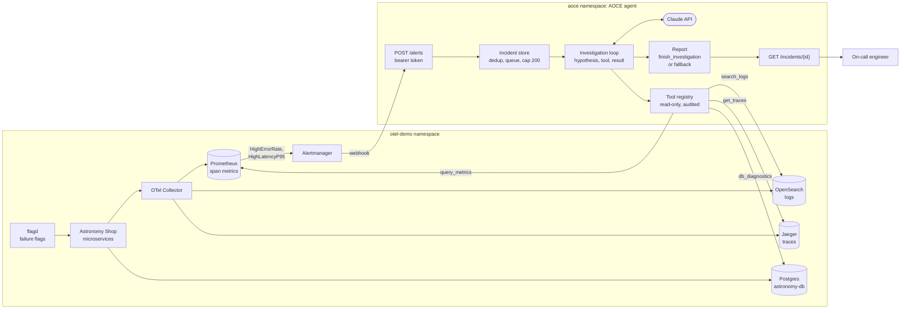
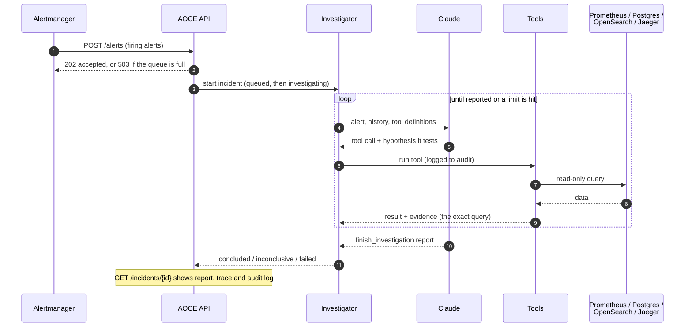

# Architecture

How a failure in the Astronomy Shop becomes a cited root-cause report: an alert opens an incident,
the investigation loop tests hypotheses with read-only tools, and the result is a report you read at
`/incidents/{id}`.

## Alert to report

## One investigation, step by step

## The pieces

| Stage | Where | What it does |
|---|---|---|
| Fault | flagd (`http://localhost:8080/feature`) | Turns on a failure scenario; ground truth is in [`eval/failure_catalogue.yaml`](../eval/failure_catalogue.yaml) |
| Detect | Prometheus rules in [`deploy/otel-demo/values.yaml`](../deploy/otel-demo/values.yaml) | `HighErrorRate` (over 5% failed for 1m) and `HighLatencyP95` (p95 over 1s for 2m) on server-span metrics |
| Notify | Alertmanager | POSTs firing alerts to `http://aoce-agent.aoce:8000/alerts` with the webhook bearer token |
| Accept | [`app.py`](../src/aoce/app.py), [`auth.py`](../src/aoce/auth.py) | Checks the token, opens one incident per firing alert, ignores re-sends, retries transient API failures up to 3 times |
| Queue | [`app.py`](../src/aoce/app.py) | 2 investigations at once, 20 more queued; beyond that the webhook answers 503 so Alertmanager retries |
| Investigate | [`investigation.py`](../src/aoce/investigation.py), [`llm.py`](../src/aoce/llm.py) | Claude forms a hypothesis, calls one tool to test it, reads the result, repeats. Limits: 12 steps, 300k tokens, 5 minutes |
| Gather evidence | [`tools/`](../src/aoce/tools/) | `query_metrics` (Prometheus), `db_diagnostics` (Postgres), `search_logs` (OpenSearch), `get_traces` (Jaeger). Read-only; each result carries the query that produced it |
| Audit | [`audit.py`](../src/aoce/audit.py) | One entry per tool call: time, tool, arguments, duration, outcome, result size |
| Report | `finish_investigation` | Summary, root cause, confidence, hypotheses with evidence, recommended action, what was and was not checked. If Claude never reports, a low-confidence fallback is built from the trace |
| Read | `GET /incidents/{id}` | Status, report, every tool call with its hypothesis, and the audit log |
